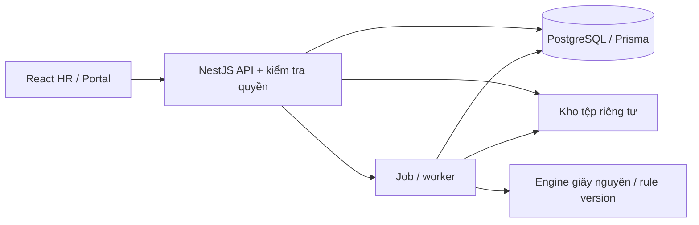

# 03 – Kiến trúc đề xuất
Trạng thái: thiết kế sơ bộ, chưa triển khai. Giữ stack người dùng ưu tiên.

## Thành phần
React + TypeScript + Tailwind: giao diện HR/portal.
NestJS + TypeScript: API và authorization theo vai trò/phạm vi.
PostgreSQL + Prisma: giao dịch, ràng buộc, migration.
Attendance Engine: thư viện TypeScript thuần, không phụ thuộc UI/DB; nhận dữ liệu đã xác minh, trả seconds theo mức cùng lỗi và rule version.
Storage nội bộ riêng tư: Excel gốc và PDF, tải qua API kiểm tra quyền.
Worker: import lớn, tính lại, xuất PDF hàng loạt; job có trạng thái/retry/idempotency. Chọn cơ chế hàng đợi sau benchmark, chưa mặc định thêm Redis.
XLSX/PDF library và phiên bản: chọn sau audit file/mẫu, kiểm tra bảo trì, bảo mật, giấy phép và hỗ trợ Unicode trước khi pin.

## Phân lớp và truy vết
Import parser → validation → normalized input → engine → versioned calculations → immutable timesheet snapshot → publication.
Dữ liệu raw và file gốc giữ nguyên; correction overlay chỉ tạo input mới cho calculation revision mới.
Ghi hash đầu vào, dòng/sheet nguồn, engine/rule version; xuất PDF/Excel từ cùng snapshot.
Cấu trúc dự kiến: apps/web, apps/api, packages/attendance-engine, prisma, docs, tests; chưa tạo mã các thư mục này.

## Giao dịch và đồng thời
Import confirm, adjustment+recalculation, chuyển trạng thái kỳ và tạo snapshot phải nguyên tử ở DB.
Kiểm tra period state/version ngay trong transaction; dùng optimistic version, khóa DB/isolation phù hợp và retry conflict có giới hạn.
Worker phải kiểm lại phiên bản/kỳ trước commit; job cũ không được ghi lên kỳ đã khóa.
Không giữ transaction mở trong lúc đọc file hoặc render PDF.
Idempotency key ngăn request lặp tạo thêm import/publication; hash file không đủ để nhận diện dòng trùng.

## Khả thi
Đề xuất modular monolith để vận hành nội bộ và kiểm toán tập trung. Quy mô 1.000 nhân viên chưa được benchmark.
Không đề xuất thay sang Apps Script/Sheets; không có thay đổi kiến trúc cần phê duyệt trong Phase 0.

## Nguồn kỹ thuật đã tham khảo 09/10/2026
- [NestJS authorization](https://docs.nestjs.com/security/authorization): cơ chế quyền theo policy; dự án cần kiểm tra cả phạm vi từng bản ghi.
- [Prisma transactions](https://www.prisma.io/docs/orm/fundamentals/transactions): giao dịch các thao tác DB; việc chọn isolation cần kiểm thử đồng thời.
- [PostgreSQL datetime](https://www.postgresql.org/docs/current/datatype-datetime.html): timestamptz biểu diễn thời điểm, không giữ tên vùng giờ gốc; lưu thêm timezone nghiệp vụ.
Không chốt phiên bản dependency hoặc khẳng định hiệu năng dựa vào các tài liệu này.
