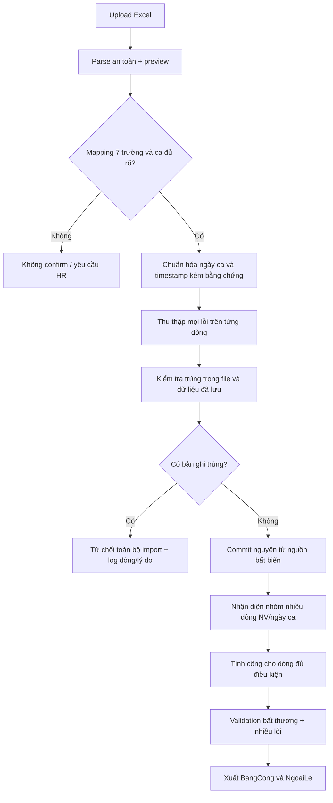

# 07 – Workflow tổng thể

Cập nhật ngày 24/10/2026 theo DEC-001–DEC-011. Workflow Phase 1 dừng ở xuất `BangCong` và `NgoaiLe`; các bước phê duyệt nhiều cấp, PDF, phát hành và portal thuộc Phase sau.

## Workflow Phase 1

## Cổng kiểm soát

### Preview và chuẩn hóa

- Preview không phải confirm; không tạo dữ liệu công chính thức.
- Chỉ dùng bảy trường nguồn. Tên ca/alias không rõ, lịch thiếu hoặc timestamp mơ hồ phải lưu lỗi, không tự sửa.
- Ngày ca lấy theo lịch phân công; ngày timestamp vào/ra giữ riêng. Ca 3 vào sau 00:00 chỉ gắn ngày ca trước khi có căn cứ (DEC-001).
- Ngày ra hôm sau chỉ được chuẩn hóa khi bằng chứng phù hợp phân ca nguồn Ca 3 19:00–07:00; lưu evidence. Thiếu căn cứ → `NEEDS_REVIEW`, không tính (DEC-002/DEC-007/DEC-008).

### Import nguyên tử

- Detector phải phân biệt `WITHIN_FILE` và `STORED_DATA`, hiển thị dòng/lý do.
- Có ít nhất một duplicate đã xác định → từ chối toàn import, không ghi một phần raw/calculation (DEC-003).
- Không overwrite/merge/replace; file sửa một dòng không phải bản thay thế mặc định.
- Metadata/audit của attempt bị từ chối được giữ; dữ liệu nghiệp vụ staging phải rollback/xóa theo transaction an toàn.
- Khóa trùng còn `OPEN`; không confirm import thực tế bằng khóa tự suy diễn.

### Tính công và ngoại lệ

- Nhiều dòng cùng mã NV/ngày ca được giữ riêng, tạo ngoại lệ và không cộng/ghép/tổng hợp trước HR xác nhận (DEC-004).
- `A=B`, duration âm sau chuẩn hóa có căn cứ hoặc hiện diện > ngưỡng cấu hình mặc định 16 giờ → HR review, không tự sửa (DEC-005).
- Validation không dừng ở lỗi đầu tiên. Một dòng lưu mọi mã lỗi; có lỗi cần HR thì hiển thị `NEEDS_REVIEW` (DEC-006).
- Chỉ dòng có timestamp/ngày ca tin cậy và không có lỗi chặn mới được tính/đưa vào `BangCong`. `NgoaiLe` phải truy vết về file/sheet/dòng và mã lỗi.
- `RESOLVED` chỉ là hành động xử lý ngoại lệ; phải validation/calculation lại thành công trước khi dòng hợp lệ.

## Workflow Phase sau (không triển khai trong Phase 1)

Luồng tổng thể dự kiến vẫn là `DRAFT → REVIEWED → APPROVED → LOCKED → PUBLISHED`, nhưng vai trò, phạm vi kỳ, reopen/revision và người duyệt độc lập còn `OPEN`.

Tại mọi bước chốt về sau:

- Còn ít nhất một lỗi blocking mở → từ chối chuyển trạng thái.
- Correction/rule/import mới không được thay đổi ngầm snapshot đã khóa/phát hành.
- Sau khóa không sửa trực tiếp; chọn reopen hoặc adjustment revision sau khi Q10 được xác nhận.
- PDF/portal/phát hành thật không thuộc Phase 1 và không được triển khai production từ tài liệu này.

## Bằng chứng và trạng thái test

Mỗi lần chạy phải lưu command, version, input hash/fixture, actual/expected và artifact. Unit/integration/E2E synthetic đã chạy theo `TEST_REPORT.md`; UAT và đối chiếu `SX.xlsx` vẫn `BLOCKED`. Workflow phụ thuộc Q10/Q11 mặc định tắt, không phải luồng đã nghiệm thu.
