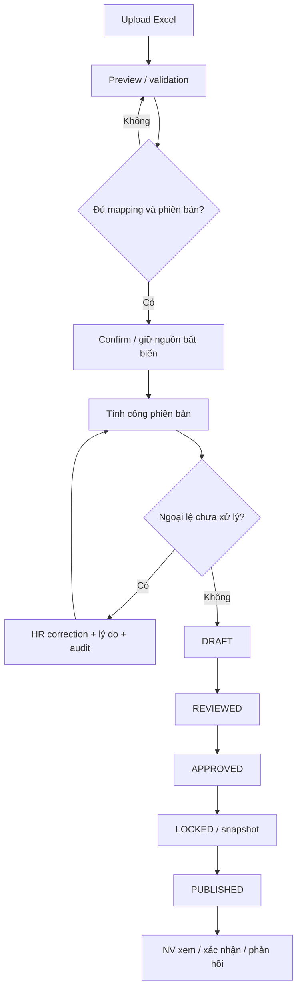

# 07 – Workflow tổng thể
Workflow chính thức: DRAFT → REVIEWED → APPROVED → LOCKED → PUBLISHED.
Đề xuất kỳ toàn công ty tháng/năm, cần xác nhận phạm vi kỳ và vai trò chuyển trạng thái.

## Điều kiện và tác động
- Preview không phải confirm. Unknown shift/ngày mơ hồ chỉ gắn lỗi, không tự sửa.
- File nhiều tháng phải đối chiếu lock và version từng kỳ; chính sách partial/all-or-nothing cần chốt.
- REVIEWED: HR đã kiểm tra, nguồn đầy đủ, mọi dòng có trạng thái rõ; đề xuất không cho đi tiếp khi còn ngoại lệ chặn.
- APPROVED: người có quyền duyệt bản revision cụ thể; danh tính/độc lập người duyệt cần xác nhận.
- LOCKED: kiểm tra lại ngoại lệ, đầu vào, job pending, version; tạo snapshot trong transaction.
- PUBLISHED: artifact thành công, đúng snapshot; nhân viên chỉ truy cập bản đã phát hành. Job lỗi không đánh dấu cả lô thành công.
- NV xem/confirm/feedback gắn publication revision; phản hồi không sửa raw hoặc snapshot.
- Mutation đồng thời với khóa: một bên conflict/retry, không có correction lén ghi sau lock.
- Sau khóa/phát hành: không sửa trực tiếp. Đề xuất reopen có phê duyệt hoặc adjustment revision; chọn quy trình sau Q10, giữ PDF và lịch sử cũ.
- Sửa rule/phòng ban/import không được làm đổi ngầm bản đã phát hành.

## Phạm vi kiểm thử
Test tất cả cạnh hợp lệ và chuyển trạng thái sai, thiếu quyền, ngoại lệ mở, version cũ, job cũ, publication lặp, correction sau lock và cập nhật đồng thời.
Không thực hiện production hoặc gửi thật trong Phase 0.
